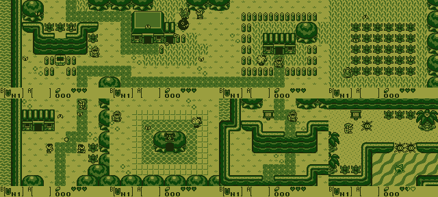
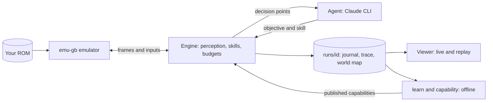

# Koholint

[](https://github.com/kaderate/koholint/actions/workflows/ci.yml)

**An autonomous player of *The Legend of Zelda: Link's Awakening DX*: a deterministic engine, LLM agents called only when a decision is needed, and a loop that improves the framework as the game teaches it new things.**



*Eight of the places one run discovered by itself, captured by the engine.*

## Why it is interesting

- **Deterministic by construction.** The game runs headless in an emulator and time is the frame. An input journal plus the ROM *is* the run: any state can be replayed, forked or verified.
- **Agents only at decision points.** The engine owns the loop, the budgets and the files; the agent picks objectives and skills (explore, walk, talk, attack, use an item) and the engine executes them frame by frame. That keeps a run cheap, bounded in time and money, and reproducible.
- **No walkthrough.** The agent knows how Game Boy games work and how this one is played (controls, menus, map). Where to go and what to do is observed or read from in-game texts, and every game fact lives in typed data with provenance.
- **It improves itself.** Runs emit symptoms and suggestions, offline commands propose, try and judge new *capabilities*, and a published capability becomes a skill the agent can use.
- **Watch it think.** A built-in viewer shows the game screen, the agent's reasoning, the world map it builds, and the cost curve, live or as a replay.

## Where it stands

Honest numbers, from [`ROADMAP.md`](ROADMAP.md) and [`docs/runs/index.md`](docs/runs/index.md):

- The agent plays from the title screen, explores the overworld, talks to people and reads signs, and **obtained the shield and the sword** (the sword in run [`20261111-194737-9ba1`](runs/20261111-194737-9ba1/): 42 places, 62,457 frames, 4.32 USD, item gained at frame 60404 in room 242/0).
- It strikes enemies with the sword and keeps track of leads (open, tested or refuted) found in dialogues.
- The longest run so far, [`20261113-090835-21b0`](runs/20261113-090835-21b0/), saw **63 places in 84,235 frames for 6.92 USD**: 21 places new to its lineage, found with a learned capability. Archived runs cost roughly 0.04 to 0.4 USD per 1000 frames.
- That capability, `sword-on-object-92` (use the sword on a room object that blocks the way), is the one operational learned capability; in a checkpointed A/B it let all three forks reach a place (164/17) no archived run had seen.
- Not done yet: the first dungeon is the next goal, and a validation run from zero is still pending. See the [roadmap](ROADMAP.md) for what remains.

## How it works



The engine reads the game state from RAM, builds a belief grid of the screen, and asks the agent only at decision points (a new place, an objective to choose, a dialogue to read). Everything else is deterministic skills. Layers, data flow and invariants are in [`ARCHITECTURE.md`](ARCHITECTURE.md).

## Quick start

**Requirements**

- Ruby 4.0.1
- [emu-gb](https://github.com/kaderate/gemboy) (public repo `kaderate/gemboy`), checked out locally
- Your own copy of the *Link's Awakening DX* ROM, revision 1 (the file is named `zelda_dx_rev1.gbc` in `.env.example`). It is **not provided and never committed**, and a run resumes only with the same ROM hash, so keep to one revision.
- The [Claude CLI](https://docs.claude.com/en/docs/claude-code) for agent runs (`claude -p`)

**Configure**

```sh
cp .env.example .env   # gitignored; set KOHOLINT_ROM and EMU_GB_HOME
```

**Play and watch**

```sh
# one terminal: play with the agent, paced to real time, with a 1.5 USD / 25 minute budget
bin/koholint run --agent --realtime --grid --max-dollars 1.5 --minutes 25 --root /tmp/koholint-live

# another terminal: open the viewer on that run, then visit the printed URL
bin/koholint watch /tmp/koholint-live/<id> --port 8123 --from live
```

The viewer also browses and compares every run under a runs root (`/runs`). Without `--agent` the engine plays a scripted walk with no model calls. Archive a finished run into git with `bin/koholint archive --from /tmp/koholint-live --commit`.

Every command and option (budgets, resume, fork, branch, A/B, censuses, run storage) is in [`docs/OPERATING.md`](docs/OPERATING.md).

## Tests

```sh
rake test:fast   # skips the ROM-heavy files, about 35 s
rake test:ci     # every file with the ROM hidden (ROM tests skip), about 25 s: what CI runs
rake test        # full suite, about 4 min on a busy Mac (the first run builds an emulator state cache in tmp/)
```

GitHub Actions runs `rake test:ci` on every pull request and push to `main`, with emu-gb cloned from `kaderate/gemboy`. The full suite needs the ROM and emu-gb configured as above, and is run locally once before each merge. After a boot script or perception change, `bin/generate_start_fixture` regenerates `test/fixtures/start_game.expected.json`, which `test/perception_test.rb` reads.

## Project layout

| Path | What is there |
|---|---|
| `bin/koholint` | The command line |
| `lib/koholint/` | Engine, perception, vision, skills, policies, viewer |
| `data/` | Typed game facts with provenance: addresses, items, entities, modes, capabilities |
| `runs/` | Archived runs (light bundles: journal, trace, world map, screenshots) |
| `docs/` | Operating guide, agent skills, run reports, specs and plans |
| `test/` | Minitest suite |

## Read more

- [`ARCHITECTURE.md`](ARCHITECTURE.md): layers, data flow, invariants
- [`ROADMAP.md`](ROADMAP.md): what remains
- [`docs/OPERATING.md`](docs/OPERATING.md): commands, viewer, run storage
- [`docs/AGENT_SKILLS.md`](docs/AGENT_SKILLS.md): what the agent can do (per flow)
- [`docs/runs/index.md`](docs/runs/index.md): every archived run
- [`docs/superpowers/specs/`](docs/superpowers/specs/): design rationale
- [`docs/RETROSPECTIVE.md`](docs/RETROSPECTIVE.md): lessons from v1, archived under the git tag `v1-archive`

**For AI agents working on this repo:** read [`AGENTS.md`](AGENTS.md) first.

## Legal

Koholint contains no Nintendo code, ROM, or game manual. You must supply a ROM you legally own; it is read from `$KOHOLINT_ROM` and never committed. *The Legend of Zelda: Link's Awakening* is a trademark of Nintendo; this project is independent and unaffiliated. Code under GPL-3.0 (see [`LICENSE`](LICENSE)).
