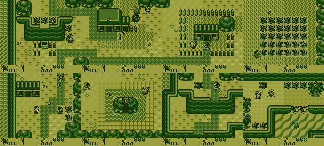
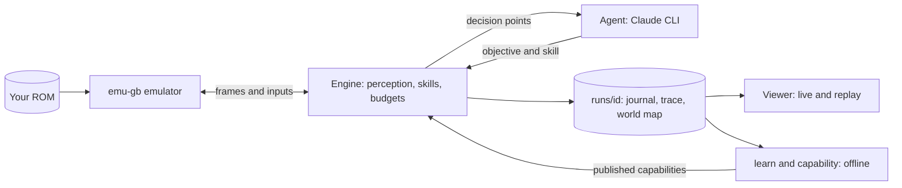

# Koholint

[](https://github.com/kaderate/koholint/actions/workflows/ci.yml)

**An autonomous player of *The Legend of Zelda: Link's Awakening DX*: a deterministic engine, LLM agents called only when a decision is needed, and a loop that improves the framework as the game teaches it new things.**



*Eight of the places one run discovered by itself, captured by the engine.*

## Why it is interesting

- **Deterministic by construction.** The game runs headless in an emulator and time is the frame. An input journal plus the ROM *is* the run: any state can be replayed, forked or verified.
- **Agents only at decision points.** The engine owns the loop, the budgets and the files; the agent picks objectives and skills (explore, walk, talk, attack, use an item) and the engine executes them frame by frame. That keeps a run cheap, bounded in time and money, and reproducible.
- **No walkthrough.** The agent knows how Game Boy games work and how this one is played (controls, menus, map). Where to go and what to do is observed or read from in-game texts, and every game fact lives in typed data with provenance.
- **It improves itself.** Runs emit symptoms and suggestions, offline commands propose, try and judge new *capabilities*, and a published capability becomes a skill the agent can use.
- **Watch it think.** A built-in viewer shows the game screen, the agent's reasoning, the world map it builds, and its spend against the budget, live or as a replay.

## Where it stands

Honest numbers, from [`ROADMAP.md`](ROADMAP.md) and [`docs/runs/index.md`](docs/runs/index.md):

Below, *model* means a run where Claude made the decisions and was paid for them, and *$0 stub* means a fork whose decisions came from the deterministic stub picker, with no model call.

- The agent plays from the title screen, explores the overworld, talks to people and reads signs, and **obtained the shield and the sword** (model; the sword in run [`20261111-194737-9ba1`](runs/20261111-194737-9ba1/): 42 places, 62,457 frames, 4.32 USD, item gained at frame 60404 in room 242/0).
- It strikes enemies with the sword and keeps track of leads (open, tested or refuted) found in dialogues.
- **The mushroom (item 12)** was picked up in room 80/0 at frame 91615 by model run [`20261124-190747-626d`](runs/20261124-190747-626d/) (a fork of checkpoint `20261114-084732-45ba`, 0.33 USD of its own). Model-free stub forks of the same checkpoint picked it up too. 626d and its $0 stub fork [`20261124-191800-abbe`](runs/20261124-191800-abbe/) reached 68 places, the most of any archived run.
- **The mushroom was delivered and became the Poudre Magique** only in two $0 stub runs, `20261125-232412-ef41` and `20261125-232411-2dd7` (flow-101, forks of abbe, not archived yet). Each healed or pushed its way to the hut 162/14 and handed the mushroom over, and the game answered « Tu as la Poudre Magique! ». No model run has done this yet. The engine names item 12 by a RAM count (0xDB4C) seen in both runs, which fork the same parent and so count as one lineage (the name stays `observed`), and emits a gain when the mushroom becomes the powder.
- **Stone rooms:** stones slide when Link holds a direction into them (flow-82), and explore searches for the pushes that open an exit (flow-89). In the $0 stub run 2dd7, it pushed through the stones of 171/10 to go on.
- **Souvenirs** (flow-99): when a person in another branch of the run tree (`data/souvenirs.json`) named an item Link now holds, and this lineage never heard it, that person becomes a candidate objective, quoted as a souvenir of another playthrough.
- **The cockpit:** `bin/koholint watch` serves the cockpit at `/`: Île (the overworld screens seen across runs), Direct (one run as it plays or replays) and Métro (the lineages that reached something new). The older run page with the debugging tools stays at `/live`.
- The one operational learned capability, `sword-on-object-92` (use the sword on a room object that blocks the way), let all three forks of a checkpointed A/B reach a place (164/17) no archived run had seen. Archived runs cost roughly 0.04 to 0.4 USD per 1000 frames.
- [`docs/runs/index.md`](docs/runs/index.md) lists each archived run's first gains and the items it held at the end.
- Not done yet: after the delivery, the stub gates stall on examine and talk objectives; a paid validation of the delivery is pending; the first dungeon is the next goal. See the [roadmap](ROADMAP.md) for what remains.

## How it works



The engine reads the game state from RAM, builds a belief grid of the screen, and asks the agent only at decision points (a new place, an objective to choose, a dialogue to read). Everything else is deterministic skills. Layers, data flow and invariants are in [`ARCHITECTURE.md`](ARCHITECTURE.md).

## Quick start

**Requirements**

- Ruby 4.0.1
- [emu-gb](https://github.com/kaderate/gemboy) (public repo `kaderate/gemboy`), checked out locally
- Your own copy of the *Link's Awakening DX* ROM, revision 1 (the file is named `zelda_dx_rev1.gbc` in `.env.example`). It is **not provided and never committed**, and a run resumes only with the same ROM hash, so keep to one revision.
- The [Claude CLI](https://docs.claude.com/en/docs/claude-code) for agent runs (`claude -p`)

**Configure**

```sh
cp .env.example .env   # gitignored; set KOHOLINT_ROM and EMU_GB_HOME
```

**Play and watch**

```sh
# one terminal: play with the agent, paced to real time, with a 1.5 USD / 25 minute budget
bin/koholint run --agent --realtime --grid --max-dollars 1.5 --minutes 25 --root /tmp/koholint-live

# another terminal: open the viewer on that run, then visit the printed URL
bin/koholint watch /tmp/koholint-live/<id> --port 8123 --from live
```

The viewer also browses and compares every run under a runs root (`/runs`). Without `--agent` the engine plays a scripted walk with no model calls. Archive a finished run into git with `bin/koholint archive --from /tmp/koholint-live --commit`.

Every command and option (budgets, resume, fork, branch, A/B, censuses, run storage) is in [`docs/OPERATING.md`](docs/OPERATING.md).

## Tests

```sh
rake test:fast   # skips the ROM-heavy files (HEAVY in the Rakefile), about 25 s
rake test:ci     # every file with the ROM hidden (ROM tests skip), about 25 s: what CI runs
rake test        # full suite, about 4 min on a busy Mac (the first run builds an emulator state cache in tmp/)
```

GitHub Actions runs `rake test:ci` and the whole suite with the ROM (4 shards) on every pull request and push to `main`, with emu-gb cloned from `kaderate/gemboy` and the ROM decrypted from an age-encrypted download (see `docs/OPERATING.md`), so the full suite need not run locally before a merge. After a boot script or perception change, `bin/generate_start_fixture` regenerates `test/fixtures/start_game.expected.json`, which `test/perception_test.rb` reads.

## Project layout

| Path | What is there |
|---|---|
| `bin/koholint` | The command line |
| `lib/koholint/` | Engine, perception, vision, skills, policies, viewer |
| `data/` | Typed game facts with provenance: addresses, items, entities, modes, capabilities |
| `runs/` | Archived runs (light bundles: journal, trace, world map, screenshots) |
| `docs/` | Operating guide, agent skills, run reports, specs and plans |
| `test/` | Minitest suite |

## Read more

- [`ARCHITECTURE.md`](ARCHITECTURE.md): layers, data flow, invariants
- [`ROADMAP.md`](ROADMAP.md): what remains
- [`docs/OPERATING.md`](docs/OPERATING.md): commands, viewer, run storage
- [`docs/AGENT_SKILLS.md`](docs/AGENT_SKILLS.md): what the agent can do (per flow)
- [`docs/runs/index.md`](docs/runs/index.md): every archived run
- [`docs/superpowers/specs/`](docs/superpowers/specs/): design rationale
- [`docs/RETROSPECTIVE.md`](docs/RETROSPECTIVE.md): lessons from v1, archived under the git tag `v1-archive`

**For AI agents working on this repo:** read [`AGENTS.md`](AGENTS.md) first.

## Legal

Koholint contains no Nintendo code, ROM, or game manual. You must supply a ROM you legally own; it is read from `$KOHOLINT_ROM` and never committed. *The Legend of Zelda: Link's Awakening* is a trademark of Nintendo; this project is independent and unaffiliated. Code under GPL-3.0 (see [`LICENSE`](LICENSE)).
