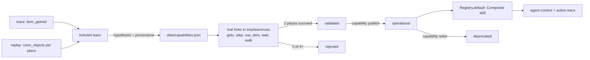

# Capability learning: the smallest vertical slice (2026-11-12)

First step of ROADMAP item "Capability learning loop" (brief: `docs/research/AUTO_IMPROVEMENT_BRIEF.md`, improvement levels:
`2026-10-24-screen-protocol-and-improvement-loop-design.md`). This note maps the extension points of today's code (main at
`414f409`, flow-39), fixes the one slice the next PR builds, how it is measured and tested, and the first candidate. It adds no
layer: the new skill is a skill, the new data file is a data file with provenance, the learner is an offline command like the
censuses.

## The slice in one paragraph

After a run, `koholint learn <run_dir>` reads the trace for a trigger (an `item_gained` event), replays to the first ready frame
of each place seen after it and reads the room object table there, and proposes candidates of one generic shape: *use the new
item facing an uncatalogued solid object*. Each candidate is a composition of existing skills (`goto`, `step`, `use_item`, `wait`, `walk`) and
is written to `data/capabilities.json` as `hypothesis` with its provenance. The learner tests it on throwaway forks of the run
(`Run#fork` into `tmp/learn/runs`, an `Engine` driven by a scripted policy, a frame budget, no model call, no RAM write) and
judges it from the action results (walking into the object's cell is blocked before the item is used and enters it after) and
from the cell's object id read before and after.
Two successes in two different places make it `validated`; `koholint capability publish <id>` makes it `operational`, which
puts it in the skill registry, lists it in the agent's context when its object is on screen, and traces it in every `action`
event; `koholint capability retire <id>` rolls it back. Progress is measured by an A/B of forks with the capability on and off.

Out of the slice: a model writing hypotheses (the deterministic shape above needs none for the first candidate; a learner
prompt comes when a trigger has no template), the MetaPlanner, generated Ruby, online learning during a run, and feeding
validated effects into explore (next step, below).

## First candidate

**The sword strike is moot as a learning target.** `attack` (flow-38, `skills/attack.rb`, 195 lines) already strikes, and it is
not a composition of existing skills: it lines up in pixels against `sword_reach`, reads `entity_health` per hit and walks
back after knockback. Re-deriving it from `goto`/`walk`/`press` would only measure the limits of the composition format and
add nothing to game progress, so the slice does not try it.

**Next real candidate: the sword on room object `0x5C` (92).** It is the one obstacle the harness has recorded as unexplained:
`docs/loose-ends.md` (room 227 west pocket) says Link lands in a pocket closed by `0x5C` at (3,2) and (4,2), solid to A, push and
the raised shield, "how it opens is not measured (no item to test with)". After the sword it is common: in run
`20261112-103604-0c64` (flow-38, fork of `sword-obtained`) it is in 5 of the 17 places reached after frame 60404 (224, 209, 193,
176, 160; 224 is four screens from the checkpoint). A probe on throwaway copies of that run (Link placed next to each `0x5C`
cell, facing it, A for 3 frames, 30 idle frames; script outside the repo) shows the candidate is real:

| state | strikes (A) | `0x5C` became `0x04` | control (no A) changed | walked into the cell after |
|---|---|---|---|---|
| 224/0 at frame 64140 | 10 (3 cells, every free side) | 10 | 0 of 10 | 6 of 10 |
| 209/0 at frame 66022 | 14 (5 cells) | 14 | 0 of 14 | 11 of 14 |

The probe placed Link by a RAM write, which censuses may do and a validation may not, so it is evidence that the experiment
is worth building, not the validation itself: the learner must reach the same result through skills only. The 7 walks that
did not enter the cleared cell are unexplained (no screenshot taken), which is why the oracle reads the object id as well as
the walk, and why one trial never rejects a candidate. Whether `0x5C` gates the way to the
first dungeon is not known and is not looked up (walkthrough knowledge stays out): the A/B answers it.

## Extension points

| # | where (today) | what the slice needs there |
|---|---|---|
| 1 | `data/capabilities.json` (new) + `lib/koholint/capabilities.rb` (new) | List of entries `{id, name, version, status, trigger, target, steps, effect, evidence, source, history}`; loader and `validate!` in the style of `checkpoints.rb` / `items.rb` (unknown key, bad status, a step skill not in `Registry.default`, a `$param` not declared, duplicate id or name); `operational`, `digest` (sha of the operational entries) and `record!(id, status:, evidence:, reason:)`, which bumps `version` and appends to `history` so every earlier state stays readable. Statuses: `hypothesis`, `validated`, `operational`, `rejected`, `inconclusive`, `deprecated`. Name clash to keep in mind: `Vision::Capabilities` is the held-item context of beliefs (always empty today, `engine.rb` builds `GridBuilder` without it). |
| 2 | `lib/koholint/skills/composite.rb` (new) | An `Execution` that runs its steps one after the other, the pattern of `ItemRun#menu` in `skills/use_item.rb`. Each step is started through `context[:registry].start` with the composite's context, so `Shielded` wraps the moving sub-steps (`goto`, `walk`) and `triggers` still apply; the composite itself is never in `Shielded::MOVING` (no double wrap). Params `row`, `col` (Link's standing cell) and `direction` (facing the target), substituted for `$row`, `$col`, `$direction` in step params. Each step has an `accept` list of stop reasons (the facing `step` before the item: `blocked`); any other stop ends the composite with `step_failed`. Result: `Execution#result` plus `capability: {id, version}`, `steps` (skill and `stopped_by` each) and `effect` (the last step entered the target cell). Hard cap: the sum of the steps' caps (`Composite::CAPS`: 400 for `goto`, `step`, `walk`, `wait` and the other bounded skills, 900 for `use_item`, `guard` and `attack`; `explore`, which is unbounded, and the screen skills cannot be composed). |
| 3 | `skills/registry.rb` `Registry.default`, `Registry#start` | `default(capabilities: Capabilities.operational)` appends one `Composite` per entry. `Registry#start` passes itself to the skill as `context[:registry]`: `Registry.default` builds the skills before the registry exists, so a composite cannot hold it at construction. The schema enum, `DecisionPoint.choose_skill` and the delegated policy's `@skill_point` (`registry.names - SCREEN_ONLY`) pick the names up with no other change. Composites never join `Delegated::PATH_SKILLS` (their params carry a `direction` and their results no `crossed`, which the path bookkeeping expects). |
| 4 | `cli.rb` `policy_factory` and `dispatch` | Pass the operational set (or none when the manifest says `capabilities: false`) to `Registry.default`; new commands `learn <run_dir>`, `capability publish|retire <id> <why>`, `capability list`. |
| 5 | `run.rb` `Run.create`, `Run.open`, `Run#fork` | Manifest key `capabilities`: the digest, or `false` for an A/B off arm (inherited and overridable on fork like `autopilot`). `Engine.resume` refuses a run whose digest differs from the current one (`Run#check_capabilities!`; `Run.open` does not check it, so `verify`, `summary` and `fork` still open any run), so a run stays one flow while capability data changes without a code bump. Obligations in "Build PRs" below. |
| 6 | `engine.rb` `context_for` + `entities.rb` | One more context entry `room_objects: -> { Entities.room_objects(@emulator) }` (the raw 8x10 ids, read-only; `Entities.objects` keeps catalogued ids only). The trial policy reads it for the oracle, the agent context for the learned block. Nothing else in the engine: triggers are read offline. |
| 7 | `agents/context.rb` `build` (called from `Delegated#ask`) | A "Learned skills" block, only for operational entries whose target object is on screen: name, one generated line ("clears object 92: stand next to it, face it; validated in 224-0 and 209-0"), the object's cells here, and real-use counts (uses, effects). The system prompt (`agents/prompts.rb` `SKILL`) is not touched, so `prompts_sha` stays a code fact. |
| 8 | `summary.rb` `from_events`, `MANIFEST_KEYS` | `capabilities`: per `id@version`, uses, effects, frames, read from `action` results carrying `capability`; add `capabilities` to the manifest keys. |
| 9 | `ab.rb` `ARMS`, `plan`, `measure`, `criterion` | Arms `capabilities` / `no-capabilities` (fork with `--capabilities on|off`, autopilot on in both); `measure` adds `progress` = new places + items gained + milestone steps after the fork frame, and `progress_per_1000f`, `progress_per_usd`. |
| 10 | `lib/koholint/learn.rb` (new) | `triggers(run_dir)`: `item_gained` events, first ready play frame of each place after the gain (as `Summary.visited_places` reads them), room objects there through `Probes::ModeCensus.replay`. `candidates`: per gained item, the uncatalogued object ids Link never stood on, at most 3 per item by number of places, skipping any `(item, object)` already in the file whatever its status (rejected ones are not retried). `trial`: `Run#fork(at_frame:, root: 'tmp/learn/runs')`, then `Engine.resume(child.dir, policy: Trial.new(steps), budget: Budget.new(frames: <the composite's hard cap plus the ready wait>), grid: true)` (a fixed 1200 could cut `use_item`, whose cap is 900); `Trial` is a 20-line policy that reads `room_objects` at the target cell, returns the composite once, reads the cell again on the next decision and stops; the standing side is tried in order of distance from Link, and a trial that never reaches the standing cell (`goto` `no_path`/`blocked`) is `unreached` and does not count. `judge`: a trial succeeds when the composite's `effect` is true and the cell's object id changed away from the target id; `validated` at 2 successes in 2 different places; `rejected` at 0 effects over 4 or more reached trials in 2 or more places; otherwise `inconclusive`. Budget per candidate: 3 places, 2 cells each, 12 trials, no model call, $0. |

Risks found while mapping. `Run#fork` drops the events of the fork frame and keeps keyframes up to it; trial runs live under
`tmp/learn/runs`, never under `runs/`, and are never archived.
A cleared object may be transient: the game can put it back when Link re-enters the room. The criterion only looks inside one
room visit (the steps run back to back, and a `room_change` stop ends the composite with `step_failed`), so a return on
re-entry neither helps nor hurts validation; it matters for the next step (explore must remember the object as clearable,
not the cell as free), and the learner records in the entry whether the id was back on the first ready frame after a
re-entry when a trial run happens to show one. Trials write only their own run directory; the parent run and
`data/` change only through `record!`. `verify` replays inputs, so composites cannot break it. A step inside a composite is not
a decision, so the objective attempts and the triggers ledger see the composite as one action, the same as `use_item` today.

## Real use, failure and rollback

Every use is one `action` event with `capability: {id, version}` and `effect`. `koholint learn` on any later run also reads
those uses: an operational entry with fewer effects than half of at least 4 real uses goes back to `validated` (unpublished)
with the uses as evidence, so real failures demote it instead of hiding. `capability retire` sets `deprecated` with a reason;
the history keeps every version, so publishing again is one command. A run in progress is never changed under it (point 5).

## How progress is measured

Primary: game progress per 1000 frames, where progress counts new places, items gained and milestone steps after the fork
frame. Secondary: progress per dollar, model calls per 1000 frames, capability uses and effects, and the learner's own cost
(frames, $0 expected). Number of skills is not a metric.

Pre-registered comparison for the first candidate: `ab-plan` from `sword-obtained` (run `20261111-194737-9ba1`, frame 60404),
arms `capabilities` and `no-capabilities`, 3 forks each, 6000 frames, `--max-dollars 1` each (at most 6 USD, asked before
running). Three forks per arm cannot show a progress difference, so the pass rule is about use: the agent chooses the capability
in at least 2 of the 3 `capabilities` forks and at least one use has `effect` true. Progress per 1000 frames and per dollar is
reported per fork as a guard only (a clear drop against the `no-capabilities` forks is a finding to explain, not a verdict).
Before spending, an offline check replays the earlier sword runs (`0c64`, `4ec5`) over the frames a fork would play and confirms
that `0x5C` is on screen in places they reach within 6000 frames of the checkpoint (224 is reached about 3700 frames after it in
`0c64`); if it is not, the A/B starts from a later fork point instead. If the agent never uses the skill, that is the finding,
and it points at the next step rather than at the format.

## Build PRs

The build is two PRs.

1. **PR 1, $0:** extension points 1, 2 and 10, the `room_objects` context entry of point 6 (the oracle needs it) and the `learn`
   command. It answers one question: does `0x5C` validate from skills alone on run `0c64`? No entry is published, so no run
   changes behaviour and `flow_version` stays.
2. **PR 2:** `capability publish|retire|list`, the manifest digest (point 5), the registry and agent-context wiring (points 3, 4,
   7), the summary (point 8) and the A/B arms (point 9).

PR 2 obligations for the digest:
- A manifest without a `capabilities` key (every run before PR 2) reads as the empty digest, so old runs open while nothing is
  operational.
- `false` (an off arm) and the empty digest open cleanly when nothing is operational; an off arm also opens when something is,
  since it loads no composite.
- The refusal names both digests and points at fork: "run X was recorded with capabilities A, current is B; fork it (`koholint
  fork X --at-frame N`) to continue with the current set".
- AGENTS.md: the line "Only the engine writes a run's `trace.jsonl` and `save/`. A run resumes only with the same `flow_version`
  and ROM hash. A change to the play flow means a new `flow_version`." keeps its first sentence and the rest becomes: "A run
  resumes only with the same `flow_version`, ROM hash and capabilities digest (the operational entries of
  `data/capabilities.json`). A change to the play flow in code means a new `flow_version`; publishing or retiring a capability
  changes the digest, never `flow_version`." The provenance bullet gains: "`data/capabilities.json` follows the same rule: every
  entry carries its trigger, trials and history, and `validated` needs successes in 2 independent places." The last bullet
  gains: "`learn` and `capability` are offline commands; a run never calls them."

## Test plan

All in `rake test`, no ROM, no model; the suite must stay under its 2-minute target.

- `capabilities_test`: load and every `validate!` refusal; `operational` filter; `digest` stable under key order and changed by
  a publish; `record!` bumps the version, appends history, and `retire` then `publish` restores the earlier steps.
- `composite_test`: scripted perception states (as in `skills_test` / `attack_test`): steps run in order with substituted params;
  sub-steps are started through `context[:registry]`; an unaccepted stop (including `room_change`) ends with `step_failed` and names the step; `effect` true only when the last walk enters the target cell;
  hard cap; the result carries the capability id and version; moving sub-steps get `Shielded` when entities are in the context and the composite itself is not wrapped.
- `registry_test`: an operational entry appears in `names` and the schema enum; hypothesis, validated and deprecated ones do not.
- `agents_context_test`: the learned block appears only when the target object is in `room_objects`, lists its cells and counts.
- `learn_test`: candidates from synthetic events and object grids (dedup against the file, rejected not retried, cap of 3, no
  candidate for an object Link stood on); `judge` (effect without an id change is not a success, 2 places validated, 2 cells of one place inconclusive, 0 of 4 rejected,
  unreached not counted); `Trial` returns the composite once then stops; demotion from real-use counts.
- `run_test` (PR 2): the digest is in the manifest; a manifest without the key and one with `false` open; `open` refuses another
  digest with a message naming fork; fork inherits and overrides `capabilities`.
- `summary_test` and `ab_test`: capability usage block; the new arms and the progress columns.
- Not in `rake test` (needs a sword state, 60,000 frames from boot): `koholint learn` on run `0c64` end to end, run once by hand
  and reported in the PR (expected: `sword-on-object-92` validated from 224 and 209, a few thousand frames, $0).

## PR 1 outcome (2026-11-12)

`koholint learn ~/Code/koholint/runs/20261112-103604-0c64 --object 0x5c` validated `sword-on-object-92` from skills alone, at $0
in 4 min 35 s: 3 successes out of 3 reached trials. The successes were (6,5) from the right and (6,7) from the left in 224/0,
and (4,2) from below in 193/0. In every success the facing step was blocked, the last walk entered the cell and its object
id went from 92 to 4. The 8 other trials were `unreached`: `goto` was blocked on the way to the standing cell. In 209/0, Link
arrives in the top-left corner and was blocked walking down at row 1 with the shield raised, and that was not investigated
further. The evidence and trial run ids are in `data/capabilities.json`; the trial runs stay local under `tmp/learn/runs`.

The first live attempt facing with `walk 1` was inconclusive (1 success, 3 failures). The input log showed the cause: a
blocked walk recentres Link with 1 or 2 frames in the opposite direction, so he faces away when the sword swings. The facing
step is now `step 16 px`, which stops `blocked` without recentring. One limit is that the widest-first ranking of uncatalogued
ids puts `0x5C` 13th on `0c64`, behind multi-cell scenery ids. Without `--object`, the default limit of 3 would test scenery
first. Each rejected scenery id costs a few minutes and $0 and is never retried, but a better ranking is still open.

## PR 2 outcome and A/B (2026-11-12)

PR 2 adds publish and retire, the digest in each run's manifest (`Run#check_capabilities!`, called by `Engine.resume` only), the registry and
context wiring, `capability_uses` in `summary.json` and the capability arms of `ab-plan` and `ab-report`.
`sword-on-object-92` is published at version 3. The offline horizon check passed: both earlier sword runs reach a place with
`0x5C` within 6000 frames of `sword-obtained`. `0c64` reaches 224 after 3730 frames (209 and 193 by 5660), and `4ec5`
reaches 225 after 4719.

The A/B used tag `cap5c` in `~/Code/koholint/runs`: 3 forks per arm from run `20261111-194737-9ba1` at frame 60404, 6000
frames and `--max-dollars 1` each. It ran on flow-39 code (main at e20c86b plus this PR, before flow-40 merged; the PR now ships as flow-42) and spent 5.04 USD
in total. It **failed** the use criterion. The capability was offered in 45 of the 117 skill prompts of the capabilities arm (in
224/0, 209/0 and 225/0) and chosen 0 times. The agent explored exits, attacked enemies and walked away at low health; no
justification mentions the object. Both arms only revisited places: every fork stayed within the parent's 42 places (no new place and no item), and the milestone ladder cannot move from `sword-obtained` (sword is its top rung), so the progress guard reads 0 in all 6 forks.
Cost per 1000 frames was 0.135 USD with the capability and 0.145 without.

What this says: offering a validated skill in the context is not enough. Nothing in the prompt tells the agent that a cleared
`0x5C` cell opens a route, and explore never sends Link there. The next step below (clearable objects as frontiers and route
cells) is where the use has to come from, and the A/B should be rerun after it.

## PR 3: clearable objects in explore and the planner (flow-43)

A published "clears object O" capability is now navigation data (`skills/clearing.rb`). Cells of O join the shield-pushed urchins
as last-resort route cells. Explore keeps them as frontiers until walked. `goto` (alone or as an explore leg) and explore's outward
step run the composite once per cell when they are blocked facing one, and record each run in the result's `clears`.
The object is read again from `room_objects` on every call, because a cleared object may return when the room is re-entered.

**Scripted proof ($0, manual measurement).** The proof is not a committed command: an ad-hoc script forked the checkpoint twice, with and without `--capabilities`, and resumed each fork through `Engine.resume` with a policy that plays explore only, with `advance_dialogue` in dialogues, for 3000 frames from the new checkpoint
`clearable-objects-160` (run `20261112-103604-0c64` at frame 68444, room 160/0). Room 160/0 has `0x5C` at (2,4), (2,5), (2,6)
and (3,8). With the capability, explore cleared (3,8), (2,6) and (2,5) (object 92 to 4 each) and entered 164/17. A rerun after the review fixes did the same, clearing (3,8) at frame 68810 and the other two at 69035. None of the 37 archived runs has been to 164/17. Without the capability, Link never left 160/0.

**A/B (tag `cap43`, 5.87 USD).** The A/B ran 3 forks per arm from the same checkpoint, 6000 frames and `--max-dollars 1` each.
New places are now counted against the whole lineage: every ancestor's trace, including frames after the fork point.
It **failed** the use criterion. Both arms had 0 capability uses, 0 new places and 0 progress. The capabilities arm cost 0.179 USD
per 1000 frames and the other arm 0.178. In every fork, the agent's first decision set the objective of talking to a person in
161/0. Explore followed that objective's exit (`known_place`) instead of a frontier, so no fork crossed a `0x5C` cell.
The forks then went back and forth between 177/0 and 169/16 (or 161/0 and 178/18), mostly ending in `no_frontier` and
"revisit npc" rounds, until the dollar cap. The harness clears the object only when explore picks a frontier behind it, and the
objective-driven autopilot never let it pick one.

## PR 4: frontier priority and loops (flow-44)

The cap43 traces showed why the harness never cleared anything in the agent loop. Room 160/0 had been surveyed with nothing
pending, so explore followed the first objective's aimed route out through a known exit. Later explores in 177/0 and 169/16
ended in `no_frontier`, and the loop detector only added a hint to the prompt. flow-44 changes this:
- Explore takes a clearable object's frontier in the current place before an aimed route.
- Once an object is cleared in a call, the frontiers behind it come next, and the survey stays pending while they remain.
- A place whose survey is pending explores its frontiers.
- A detected loop abandons the objective and explores toward the nearest place with untried work, once per detection.
- NPC revisits wait while a surveyed place still has untried work.

**Agent-loop proof ($0, manual measurement).** An ad-hoc script ran the real delegated policy and autopilot, built by
`CLI.policy_factory`, with a stub model. The stub always took the first candidate objective, which is the cap43 model's choice,
or a `new_place` objective, and answered `explore` to every skill question. It ran 6000 frames per arm from
`clearable-objects-160`.
- With the capability: 8 clears, and Link reached 164/17, a place new to the lineage.
- Without the capability: 160/0, 161/0, 177/0, and no new place.

**A/B (tag `cap44`, 3 forks per arm, 6000 frames, `--max-dollars 1` each, 4.24 USD).** It **passed** the use criterion
(chosen in 3 forks, 40 of 42 uses cleared the object).

| arm | frames | usd | usd per 1000 f | new places | progress | uses | cleared |
|---|---|---|---|---|---|---|---|
| capabilities | 18000 | 1.51 | 0.084 | 4 | 4 | 42 | 40 |
| no-capabilities | 17163 | 2.73 | 0.159 | 0 | 0 | 0 | 0 |

Every capabilities fork reached 164/17, and one also reached 128/0; none of the forks without the capability reached a new place.
Each capabilities fork broke one loop, the lineage's loop inherited at the fork frame, at its first decision. The loop break fired in 3 of 3 capabilities forks and 0 of 3 baseline forks, because only the clearable cells gave 160/0 untried work. So "chosen in 3 of 3" overstates organic use; the cost per 1000 frames and the clear rate are unaffected.

## PR 6: ranking learn candidates by blocking evidence (flow-45, play unchanged)

`learn` now ranks uncatalogued object ids by how many distinct cells holding them stopped Link, pooled over the run's lineage:
- the cell ahead of a blocked move or edge;
- the walls explore found;
- the target of a capability use whose step into it was blocked.

Ties go to the id seen in the most places. The lineage is the run's oldest ancestor under the same runs directory plus every run
descending from it. That makes 32 runs for `0c64`, including the flow-44 run `21b0` and the cap44 forks.

**Measured on `0c64` ($0, sword gained at frame 60404, 17 places):**

| evidence | top of the ranking (blocked cells / places) |
|---|---|
| widest first (before) | 0x27 (10p), 0x2F (10p), 0x25 (9p); 0x5C 15th |
| the run's own trace | 0x1F (29/4), 0x49 (7/5), 0x60 (7/1); 0x5C 17th (2/5) |
| pooled lineage | 0x1F (33/4), 0x48 (8/5), 0x49 (8/5), 0x60 (7/1); 0x5C 8th (5/5) |

Learn with the default limit on the run's own ranking tried `0x1F`, `0x49` and `0x60` with the sword. All three came back
inconclusive, with failures and no clear:
- `0x1F`: 3 failures in 242/0 and 243/0, 3 unreached.
- `0x49`: 1 failure in 224/0, 14 unreached.
- `0x60`: 1 failure in 177/0, 4 unreached.

Those entries are now in `data/capabilities.json`. `0x1F` failed in 2 places, so it is no longer retried; the other two stay
retryable. So the done criterion (a real clearable object within the default limit) is **not met**. Most blocked cells in this
lineage belong to scenery that explore's vision took for passable or unknown. `0x5C` is capped by its few cells: 4 in 160/0,
where every pooled block comes from, and the cap44 forks cleared those before ever walking into them.

**Retries and limit 10 (review of PR 6).** A retry now tries only (place, cell, stand) triples that are not already in the entry's
evidence, and a pair stays retryable while some triple is left; this replaced the stop after failures in 2 places. With
`LIMIT` raised to 10, `learn` with the defaults on `0c64` took **3933 s** (about 66 minutes), against a copy of the capabilities
file without `sword-on-object-92`. It tried 0x48, 0x49, 0x60, 0x25, 0x39, 0x3D, 0x5C, 0xC8, 0x62 and 0x37, in ranking order.
It **validated `sword-on-object-92` by itself at $0** (3 successes in 224/0 and 193/0, 8 unreached). 0xC8 was rejected
(3 failures, 1 not solid), and the other 8 were inconclusive, mostly unreached. 0x1F was not retried because no untried triple
was left in its first places. The new entries, except the duplicate 0x5C one, are in `data/capabilities.json`.

**Reaching the standing cell (flow-51).** In that run 94 of 115 trials were unreached: the composite's goto ended `blocked` 86
times, `no_path` 7 times and `room_change` once. Re-running goto alone toward 24 of them showed two causes. Some edges the grid
believed open were walls, and goto gave up at the first one even when another route existed (241/0 from (3,9)). Others led
nowhere: 192/0's arrival is a door cell whose only exit is back down (a walk up stops after 3 px, left does not move), and 208/0's
upper part is cut off at (5,8) up. Learn kept trying every other standing cell there, and each trial hit the same wall.

The fix lives in the existing layers. goto now avoids a blocked edge and replans from where Link stands, up to 3 times (explore
and talk_to keep their own replanning). goto returns the edges it went around (`avoided`), and the delegated ledger records them with `blocked_at`. An unreached trial
records every edge that stopped its goto. A wall counts once trials in 2 different runs hit it, like any fact checked twice,
because one blocked trial may be a passing enemy. Learn skips a standing cell the shared planner cannot reach from the arrival
while avoiding the confirmed walls of that place, and it adds those walls to each trial's ledger as doubtful edges.

Same start (the catalogue at 05d5280 without `sword-on-object-92`), defaults, `0c64`, $0:

| | trials | unreached | failure | success | not solid | skipped, no path | wall time |
|---|---|---|---|---|---|---|---|
| before (flow-49) | 115 | 94 (82%) | 17 | 3 | 1 | – | 3933 s |
| after (flow-51) | 61 | 38 (62%) | 19 | 3 | 1 | 24 | 2988 s |

The verdicts did not change: `sword-on-object-92` validated again, 0xC8 rejected, the other 8 inconclusive. So nothing new
was recorded in `data/capabilities.json`. The 38 unreached trials left:
- 9 hit the composite's frame cap during goto.
- 21 were blocked: pockets and one-way areas, each hit until trials in 2 runs confirm the wall.
- 6 were `no_path`, where the live grid disagrees with the sighting's.
- 2 were `room_change`: one into the off-grid exit at the bottom of 208/0, one in 176/0.

**Exact centring (flow-54).** In 208/0, every goto toward the upper part stopped at (5,8) up, 3 px left of the stairs' centre. A
probe showed that Link climbs the stairs only when exactly centred: from x 133 he is blocked, from x 136 he passes. goto now backs off to
the cell's centre, centres exactly across the move and tries the same edge once more before replanning. Re-measured as above: 63
trials, 40 unreached (63%), 22 skipped, 3095 s (flow-51: 61, 38, 24, 2988 s), with the same verdicts. The 208/0 trials now reach the
stairs but end on damage from an enemy there, like 240/0's crabs. Damage is the largest remaining cause (13), and goto stops on it
by design.
