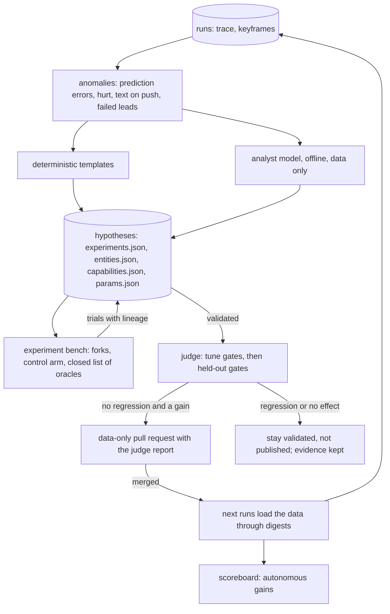

# Self-improvement loop: learned data judged by a held-out bench (2026-11-27)

Status: proposed. Nothing in this document has landed; it extends ROADMAP items 1 and 2 and the capability-learning slice of 2026-11-12.

This is a handoff document. An agent that has read `AGENTS.md`, `ARCHITECTURE.md` and this file should be able to build it phase by phase, one pull request per phase, without asking what was meant. Where the text says "confirm in code", the fact was not checked when this was written (main at `eed4f525`, flow-113).

## 1. Goal

Make "it improves itself" true and measurable: **the system gains game progress from changes it found, tested and proposed by itself, and those changes are data, not Ruby.**

One number says whether it works, and the scoreboard prints it (phase 8):

> **autonomous gains** = first gains of the progress vector (key items, dungeons entered, instruments, places seen on held-out gates) that appear between two scoreboard lines whose only difference is a data-only commit produced by the loop.

Today that number is 0. The loop of 2026-11-12 exists but is narrow:

| What | State on main | Where |
|---|---|---|
| Hypothesis shapes the learner knows | 1: "use the newly held item facing an uncatalogued solid object" | `lib/koholint/learn.rb` |
| Learned capabilities | 11 entries: 1 `operational` (`sword-on-object-92`), 9 `inconclusive`, 1 `rejected` | `data/capabilities.json` |
| Trigger | a person runs `koholint learn` or dispatches `.github/workflows/learn.yml` | |
| Publication | a person runs `koholint capability publish` | `lib/koholint/cli.rb` |
| `suggestions.md` | created empty by `Run.create`; nothing in `lib/` writes into it | `lib/koholint/run.rb` |
| Real learning path | 113 flow versions, each a hand-written harness rule | `policies/delegated.rb`, `policies/delegated/guidance.rb`, `autopilot.rb` |
| Judge | 4 stub gates on 3 checkpoints; 2 of them fork the same run (`abbe`) | `tools/gates/gates.json` |
| `hurt` notables | read per lineage at play time; nothing promotes them to the catalogue | `lib/koholint/hurts.rb` |
| Entity facts and resume | `data/entities.json` steers play but belongs to no digest (`tools/gates/README.md` says so) | `lib/koholint/run.rb` |

## 2. Non-goals

- No agent that edits Ruby, prompts or its own skill code. Code changes stay human-reviewed pull requests with a `flow_version` bump. (Level 3 of the 2026-10-24 design stays "later".)
- No learning during a run. `AGENTS.md` keeps: "a run only emits `suggestions.md`; `learn` and `capability` are offline commands; a run never calls them". Every command below is offline.
- No new harness rule. The rule freeze of `ROADMAP.md` holds. Phases 2 and 4 **remove** rule code by replacing it with facts.
- No walkthrough knowledge, from any source, including the analyst model of phase 5 (section 6).
- No new layer or role. A learner is an offline command like the censuses; a fact is an entry of an existing typed data file where one exists.
- No automatic merge of anything but the data-only pull request of phase 7, which merges itself under the standing grant that phase adds to the root `AGENTS.md` (owner's decision of 2026-11-27).

## 3. Principles

1. **What is learned is data with provenance.** Same rule as the rest of the repo: `hypothesis` until measured, `verified` needs agreeing evidence from 2 root lineages (distinct from-boot ancestors, `Bench.lineage_root`), every entry carries its trials, negative ones included.
2. **The bench decides, never the proposer.** A deterministic template, a model or a person may propose; only an experiment on throwaway forks, with a control, changes a status.
3. **Nothing reaches play without the judge.** A change is published only if the held-out gates do not regress (phase 0). Tune gates may be looked at while searching; held-out gates may only be scored.
4. **Everything that steers play is in a digest.** A learned fact that changes decisions changes a manifest digest, never `flow_version`.
5. **Stub first, dollars last.** Stub gates are deterministic and cost nothing, so any difference between two scores is real, not noise. Paid runs confirm; they do not search.
6. **Delete as much as you add.** A phase that turns a rule into a fact removes the rule in the same pull request and keeps the gate numbers, or states the numbers it moves.

## 4. Overview



New or changed pieces, by phase:

| Phase | Deliverable | Kind | Flow bump |
|---|---|---|---|
| 0 | Held-out judge (`tools/gates`: splits, lineages, `judge.rb`) | tooling | no |
| 1 | Facts digest for `data/entities.json` | run storage | no (a digest) |
| 2 | Hurts learner: `hurt` notables to verified `hurts` facts | offline learner | no |
| 3 | `anomaly` trace events from prediction errors | engine, trace, summary | yes |
| 4 | Generic experiment bench and `data/experiments.json` | offline bench | no, until a fact replaces a rule |
| 5 | Offline analyst: anomalies to experiment hypotheses | offline command, model | no |
| 6 | `data/params.json` and `tune` | data plus offline search | one bump for the extraction, numbers unchanged |
| 7 | `improve`: the nightly cycle, publish and retire proposals | orchestrator | no |
| 8 | Scoreboard `autonomy` section | tooling | no |
| 9 | Game knowledge in the manual and dungeon perception | manual, perception, data | yes |

Order is 0, 1, 2, then 3, 4, then 5, 6 in either order, then 7, 8. Phases 0 to 2 are a complete small loop on their own and should ship before anything else is started. Phase 9 depends on none of the others and can be built beside phases 0 to 2: without it the goal (instruments, dungeons) cannot be measured at all.

---

## Phase 0. The held-out judge

Without it every later phase overfits faster than a person does. Build it first.

**0.1 Gate metadata.** Each gate of `tools/gates/gates.json` gains:

```json
"sword-obtained": { "run": "20261111-194737-9ba1", "frame": 60404, "lineage": "<root run id>", "zone": "C16", "split": "tune" }
```

- `lineage` is computed by `Bench.lineage_root` and checked by a test, not typed by hand.
- `split` is `tune` or `held_out`. `test/gates_test.rb` fails unless: at least 3 held-out gates exist, they span at least 2 root lineages, and no held-out gate shares its checkpoint run with a tune gate.
- The 4 gates of today become `tune`: the rules of flows 84 to 113 were written while watching them.

**0.2 New checkpoints.** Held-out gates need lineages the rules never saw. Produce them with the existing `ruby tools/scoreboard/scoreboard.rb run --from boot` at the frozen flow, 2 runs, and cut 3 to 5 checkpoints from them with `data/checkpoints.json` entries (early overworld without the sword, after the sword, at a first death, in a place with an open puzzle). This spends real money (about 4 to 8 USD per run on past numbers): **ask the owner for the budget before running**; it is the one paid step of phases 0 to 2. Confirm in code whether run `6913` of `no-sword-225` is already a from-boot lineage distinct from `9ba1` and `abbe`; if so it counts as one.

**0.3 Score.** `tools/gates/metrics.rb` keeps its five numbers (they are regression pins). Add a progress score per gate, read with `Scoreboard::Measure` on the fork's own segment:

```
gains      = key items gained + first deliveries + dungeons entered + instruments   (higher is better)
new_places = places new to the parent's prefix                                    (higher is better)
deaths, hp_lost, stall_frames, calls                                              (lower is better)
```

Comparison of a candidate against a baseline over a set of gates is lexicographic on the sums, in that order: gains, then deaths (reversed), then new_places, then hp_lost, stall_frames, calls. The verdict is `better`, `equal` or `worse`. No weights to tune.

**0.4 `tools/gates/judge.rb`.**

```
ruby tools/gates/judge.rb --overlay DIR [--split tune|held_out|all] [--root DIR] [--json]
```

- `--overlay DIR` holds candidate copies of data files (`entities.json`, `capabilities.json`, `experiments.json`, `params.json`); files absent from it come from `data/`. Implement by passing paths to the loaders (they already take a `path`), not by writing into `data/`. Confirm every loader used by `Gates.play` can be pointed at a path; `Entities.catalogue` memoizes per path, which is what is wanted.
- It plays every gate of the split twice, baseline and candidate, and prints per gate and in total the score, the verdict and the five pin numbers. Baseline results are cached by (gate, harness sha, digests).
- Exit 0 on `better` or `equal`, 1 on `worse`.
- Publication rule used by phase 7: held-out is not `worse` **and** (tune or held-out is `better`). A change with no effect anywhere is not published; it stays `validated`.

**0.5 Speed: a verdict in seconds, a cycle in minutes.** The owner's requirement: the loop must run fast and stay reliable. Measured on main: about 96 frames per second per emulator process with YJIT (the v2 design), so one 12000-frame gate is about 2 minutes of one core; the Mac has 14 cores. Played naively, every candidate against every gate, the judge would take hours. Determinism buys the speed back without giving up reliability, in this order:

1. **Read set (exact skip).** While a gate's baseline plays, record every learned-data key the play actually reads: entity type, object id, capability id, exit edge, parameter name (a `reads.json` beside the fork, written by the loaders through one recording hook). A candidate overlay that changes no key of a gate's read set gives a play identical to the baseline frame for frame, so the gate is `equal` without being played. This is a proof, not a heuristic; a ROM test checks it on one gate by playing anyway.
2. **Fork at the first read.** When the overlay does touch the read set, the candidate equals the baseline up to the first frame that reads a changed key. Fork the candidate from the baseline's keyframe just before that frame and play only the rest. For this the judge's baseline forks write a keyframe every 600 frames instead of 1800.
3. **Baseline cache.** Baseline plays, their read sets and their keyframes are cached by (gate, harness sha, data digests) under the gates root and reused by every candidate of the cycle and of later cycles.
4. **Parallel.** One process per gate play, up to the number of cores minus 2 (`--jobs`), with the job queue of the `Rakefile` (longest first, from recorded timings).
5. **Short gates for search, long gates for publication.** A gate carries `frames`: the tune gates keep 12000; add **micro gates** of 2000 to 3000 frames cut at the places where the anomalies of phase 3 occur. Search (phase 6) and per-fact judging (phase 7 step 4) use micro gates and whatever full gates the read set leaves; the full set is played once, on the union, before publication.
6. **Early stop.** A candidate play stops as soon as the frames left cannot change its verdict against the baseline. Only stops provable from the lexicographic order are allowed: a candidate that already shows more gains than the baseline's final total is `better` whatever follows; a candidate with fewer gains is never stopped early, because a gain may still come.

Three tiers follow, each with a wall-time budget that is part of "done when":

| Tier | What | Frames | Budget on the Mac |
|---|---|---|---|
| 1 | one experiment trial (phase 4) | 100 to 600 | under 10 s |
| 2 | one candidate fact against the gates its change can affect | micro gates, forked at the first read | under 60 s |
| 3 | the union of accepted facts against every gate, both splits | full gates, parallel | under 5 min |

A whole `improve` cycle (phase 7) with templates only must finish in under 15 minutes for 20 hypotheses. `judge.rb` prints the wall time per tier and how many gate plays the read set and the cache avoided; a tier over its budget is a failed check in the cycle's report, not a silent slowdown.

Also measure once, and record in `docs/OPERATING.md`, the frames per second of a stub gate with and without `--grid` and screen captures: if perception costs more than the emulator, the judge's forks skip what a stub never reads (place screenshots, viewer feed). Do not change the emulator in this spec.

**0.6 The stub is not the model.** The stub judge filters; it does not prove. Once a week, or after 3 published changes, the standard paid `scoreboard run` (from boot plus one held-out checkpoint) is the confirmation, and its line is what phase 8 reads.

**0.7 Frontier checkpoints: how progress carries from run to run.** No run is "the save". Progress carries through data (every later run loads it) and through checkpoints (a later run may fork from one). Make the second explicit and checked:

- `data/checkpoints.json` entries gain `lineage` (computed), `vector` (the scoreboard progress vector at that frame) and `role`: `frontier`, `held_out` or `regression`.
- **Promotion.** `bin/koholint checkpoint propose <run_dir>` (offline) proposes a new `frontier` when a run's progress vector is strictly above every existing checkpoint's on its first component that differs (instruments, dungeons, key items, then places), at the first ready keyframe after the gain, with full health or the health it had. A person or the cycle of phase 7 commits it; it is data.
- **Advance from the frontier.** Paid runs that aim at new progress fork from the highest frontier; that is what keeps a run from paying again for the intro.
- **Prove from boot.** A frontier reached by one root lineage only is `observed`. It becomes `verified` when a from-boot run of another lineage, at a flow frozen for that run, reaches the same vector component. The scoreboard shows the highest frontier and the highest verified frontier side by side; the gap between them is the amount of progress that rests on one lineage. Each paid confirmation of 0.6 includes one from-boot run for this reason.
- **Old frontiers become gates.** When a frontier is passed, its checkpoint stays as a `regression` gate (tune split), so what was once reached stays reachable.
- `test/checkpoints_test.rb` checks the computed fields, and that a `verified` frontier names 2 lineages.

**Tests.** ROM-free: split and lineage validation on fixtures, the comparison function on tables of numbers, overlay path resolution. ROM: one short gate played with an empty overlay equals the baseline exactly.

**Done when.** `judge.rb --overlay <empty dir> --split all` prints `equal` on every gate twice in a row, the second time from the cache in under 5 seconds; an overlay that changes one fact no gate reads is judged `equal` with zero gate plays; the three tier budgets of 0.5 hold on the Mac; and `gates_test.rb` enforces the split rules.

## Phase 1. A digest for entity facts

`data/entities.json` changes play (`kind`, `moves`, `contact_px`, `sword_hits`, `hurts`, `heals`, `push`, `faces`) and is in no manifest digest. Once a learner writes to it, a resumed run could silently play with other facts.

- Add `Entities.digest`: SHA-256 over the play-steering fields of every entry, sorted, notes and sources excluded (same shape as `Exits.digest`).
- `Run.create` records `entities` in the manifest; `Run#check_entities!` refuses a resume on a changed digest, like `check_exits!`. A manifest without the key is a legacy run: resume is allowed and the digest is written at the next stop (confirm how `capabilities` treats the missing key and do the same).
- `ab-report` refuses arms whose entity digests differ, like souvenirs.
- Update `AGENTS.md` (the list of digests a resume needs), `ARCHITECTURE.md` (run storage) and `docs/OPERATING.md` (manifest fields) in the same commit.

**Done when.** Editing one `hurts` value makes a resume of a run recorded before the edit fail with a message that names both digests, and editing a `note` does not.

## Phase 2. The hurts learner (first complete loop)

The smallest learner that closes the loop end to end, already asked for in `ROADMAP.md` ("Hurt hypotheses are never verified").

**Input.** Run directories (archived bundles and local roots). For each, the `notable` events of kind `hurt` of the run's own segment (`detail`: `type`, `hit`, `place`, `cell`).

**Command.** Extend the existing command rather than adding one:

```
bin/koholint learn <run_dir>... --kind hurts [--root DIR] [--limit N]
```

`--kind capability` is the default and is today's behaviour, unchanged.

**Steps.**

1. Group notables by entity `type`; attach each to its root lineage.
2. For each type, at most `--limit` sightings, one per (lineage, place) first: fork the run at the keyframe before the notable into `tmp/learn/runs` and run the contact measurement that `Probes::EntityCensus` already does (placed contact against a cleared control; the census may write RAM, as censuses do). The control matters: a census whose cleared control also loses hp is discarded, as the type 185 note in `data/entities.json` records for run `f78e`.
3. Write the entry's `hurts` fact: `value` (largest hit measured), `confidence`, `verified_count` (number of root lineages with a valid census that agree the type hurts), `source` (runs, frames, hp before and after, control result), plus a `trials` list with every census, discarded and negative ones included.
4. `verified` at 2 lineages. A type whose valid censuses all read 0 hp against a 0 hp control in 2 lineages gets a verified `hurts` value of 0: a learned non-hostile, so the nearest-thing blame of `Hurts.in_contact` stops accusing it.
5. Print one line per type with the status change. Nothing is published here; the data file is changed in the working tree and phase 7 (or a person) runs the judge.

**What it removes.** After it lands, check which guards in `Hurts.in_contact` and the flow-110/111 probe rules only exist to compensate for unverified hostility, and delete those whose gate numbers do not move. State each deletion in the pull request.

**Tests.** ROM-free: grouping, lineage counting, status transitions and the validator (`verified` below 2 lineages is invalid) on fixture traces. ROM: one census on an archived run reproduces the type 27 contact numbers of `data/entities.json`.

**Done when.** Run on the runs that hold type 185 notables, the command reproduces by itself the hypothesis a person wrote on 2026-11-26, the judge scores the resulting overlay, and a second lineage from phase 0.2 either verifies it or leaves it `hypothesis` with the reason.

## Phase 3. Anomalies: the surprise is the signal

Today a person finds what to learn by reading traces. The engine already knows when the world surprised it; it throws the information away, except for exits (`puzzle` events in `explore_log.rb`).

**3.1 Event.** Add to `Trace::REQUIRED`:

```ruby
anomaly: %i[kind place expected observed action]
```

with `ALLOWED` kinds, each emitted at one place in the code where the mismatch is already computed (the file names in the last column are where to look first; confirm in code):

| kind | expected | observed | where |
|---|---|---|---|
| `blocked_known_open` | a planned step over a cell believed walkable | `blocked` at that edge | `ledger.rb`, `skills/goto.rb` |
| `open_known_blocked` | a cell believed solid | Link stands on it | `vision/beliefs.rb` |
| `text_on_push` | a push or walk | a dialogue opened with no talk target | `skills/execution.rb` (scene stop) |
| `unpredicted_damage` | no hostile within reach on the planned path | hp dropped | where the `hurt` notable is emitted |
| `no_effect` | a `use_item` or `talk_to` the objective predicted would open a dialogue or change the inventory | nothing changed | `policies/delegated/outcomes.rb` |
| `no_path_to_seen` | a path to an exit or thing seen on screen | `no_path` twice from different landings | `skills/explore.rb` |
| `lead_failed` | a lead's objective achieved | the objective failed twice | `leads.rb` |

`puzzle` events stay as they are; phase 4 reads both. `action` holds the skill, params and frame of the action that carried the prediction. Emitting must not change any decision.

**3.2 Summary.** `summary.rb` counts anomalies per kind and per place in `symptoms`, and fills `suggestions.md` with one line per (kind, place, target) with its frames. This is what the file was created for.

**3.3 Flow.** A new event type written during play: bump `FLOW_VERSION`, record the gate numbers, which must equal the previous flow's (the proof that nothing but the trace changed). Update `ARCHITECTURE.md` (trace events), `docs/OPERATING.md` (fields) and `docs/AGENT_SKILLS.md`.

**Check against known cases.** ROADMAP item 1(f): replay the lineages of the incidents listed in `ROADMAP.md` at the new flow (stub forks, 0 USD) and report for each whether an anomaly fires and after how many frames: the "too heavy" rock of C7 (98/0) must raise `text_on_push` at the first of its five pushes; the hut entered six times at 4 hp must raise `lead_failed`; the `no_path` of B14 (209/0) must raise `no_path_to_seen`. A known case that raises nothing is a missing kind, reported, not patched with a special case.

## Phase 4. The generic experiment bench

`learn.rb` (item on object) and `bench.rb` (exits) are the same machine: fork a keyframe, play a scripted policy, read an effect, record a trial with its lineage. Generalize once.

**4.1 Data: `data/experiments.json`.** A list; each entry:

```json
{
  "id": "push-object-32-opens-text",
  "status": "hypothesis",
  "anomaly": { "kind": "text_on_push", "run": "<run id>", "frame": 97993, "place": [98, 0] },
  "subject": { "object": 32 },
  "context": { "milestone": "sword", "held": [1, 4, 12] },
  "sequence": [
    { "skill": "goto", "params": { "row": "$row", "col": "$col" }, "accept": ["done"] },
    { "skill": "walk", "params": { "direction": "$direction", "cells": 1 }, "accept": ["blocked", "done"] }
  ],
  "control": "omit_last",
  "oracle": { "kind": "dialogue_opened" },
  "claim": { "file": "entities", "subject": { "object": 32 }, "fact": "solid", "value": true, "reason_from": "dialogue_text" },
  "trials": [],
  "source": "template text_on_push v1",
  "history": []
}
```

- `sequence` uses the step format and the skill whitelist of `Capabilities.validate_steps!` (`Skills::Composite::CAPS`); reuse the validator, do not write a second one.
- `control`: `omit_last`, `omit_step N` or `none_needed` (allowed only for oracles that are impossible without the action, such as `place_changed`).
- `oracle.kind` comes from a closed list, each a pure function of the state before and after: `object_id_changed`, `cell_entered`, `place_changed`, `hp_delta`, `dialogue_opened`, `item_gained`, `item_lost`, `entity_gone`, `entity_health_delta`, `exit_opened` (a border or door cell became walkable). A new oracle is a code change with tests; the analyst cannot invent one.
- `claim` names the typed fact a success supports, from a closed list per file (`entities`: `solid`, `push`, `hurts`, `heals`, `talkable`; `capabilities`: a composite; `exits`: an edge; leads: `refuted` with its measured alternative).
- Statuses are those of capabilities: `hypothesis`, `validated` (the effect in the action arm and not in the control, in 2 places or 2 lineages, as the claim's file requires), `rejected` (reached at least 4 times, never the effect), `inconclusive` (never reached), `deprecated`.
- A trial records run, parent, lineage, frame, place, cell, stand, direction, outcome per step, oracle reading in both arms, frames used. Reruns of the same (parent, frame, stand) are ignored, as in `Exits.record`.
- Experiments carry no digest by themselves: only the facts they promote into `entities.json`, `capabilities.json` or `exits.json` steer play, and those files have digests.

**4.2 Code.** `Bench::Experiment` (one policy class replacing the common part of the two `Trial` policies), `bench run <experiment id>... [--root DIR]` and `bench propose <run_dir>...` which turns anomalies into hypotheses through deterministic **templates**, one per anomaly kind:

| anomaly | template hypothesis | fact on success |
|---|---|---|
| `text_on_push` | pushing this object type opens that text, from 2 sides, in 2 places | object `solid` with the text as the reason; the planner stops routing through it |
| `blocked_known_open` at an object cell, item held | each held item used facing it (today's `learn`) | a capability hypothesis |
| `no_effect` on a person with an item | talk then use each held item; walk away and back then talk | a lead refuted, or a `talkable` or delivery fact |
| `lead_failed` with a measurable effect (hp, item) | redo the lead's action twice from a keyframe with the precondition true | lead `refuted`, shown as such in the prompt next to the measured alternative |
| `puzzle` (existing) | today's exit bench | exit edges |
| `no_path_to_seen` | reach the target from each landing of the place | per-landing reachability, already the cut-way notion of `explore_log.rb` |

**4.3 Migration.** Move `Learn::Trial` onto `Bench::Experiment` first (same `data/capabilities.json` output, `test/learn_test.rb` unchanged). Move `Bench::ExitTrial` only if it stays simpler; `data/exits.json` and its digest must not change in this phase.

**4.4 What it removes.** Each fact that reaches play replaces rule code: the `@too_heavy` special case once objects are learned solid; the heal-lead patches once a lead can be `refuted` by measurement. One deletion per pull request, judged by phase 0.

**Done when.** From the stored lineage of the C7 (98/0) incident, `bench propose` then `bench run` produce, with no person in between, a validated "object 32 is solid, reason: its text" fact in an overlay, and the judge reports the gate that contains the five wasted pushes as `better` or `equal` with fewer calls.

## Phase 5. The offline analyst

For anomalies no template covers. A strong model, called offline, once per anomaly cluster.

```
bin/koholint analyse <run_dir>... [--limit N] [--max-dollars X] [--model M]
```

- **Input per call:** one anomaly cluster (same kind, place and subject), the texts read at that place by this lineage (`leads.texts_at`), the place card, a **filmstrip** of the anomaly (below), the items held, the list of skills and oracles, and every experiment already tried on that subject with its result (so negatives are not proposed again).
- **Filmstrip instead of video.** The model reads images, not video, and `agents/claude_cli.rb` already sends several images in one call. Because a run replays exactly, the command replays the window around the anomaly from the nearest keyframe and captures 8 frames by default (`--frames-shown`, at most 12): 2 before the action starts, 4 spread over the action, 2 after it settles (the readiness gate says when). Each image is labelled in the prompt with its frame number, Link's cell and hp, and what changed in the entity table and the room objects since the previous image, so the model reads motion from numbers as well as from pixels. Captures go to `tmp/analyse/` and are never committed. This is for the offline analyst only: play decisions keep one image, because several images per decision would multiply the cost of every call with no measured need.
- **Output:** a JSON schema (enforced by `agents/claude_cli.rb`, as decisions are) of at most 3 experiments in the phase 4 format, each with a one-sentence `rationale` that must quote the observation or in-game text it rests on.
- **Validation before anything runs:** the phase 4 validator; the walkthrough guard of section 6; a budget in frames per experiment.
- Accepted proposals are written to `data/experiments.json` as `hypothesis`, their `source` naming the analyst model and the anomaly; refused ones go to the command's output with the reason. The analyst never writes a status, a fact or code.
- A new system prompt lives beside the play prompts but outside their digest: `Prompts.digest` hashes every string constant of `Agents::Prompts`, so the analyst prompt goes in its own module (`Agents::AnalystPrompts`), or a resume of every run would break.

The system prompt, to be adjusted only with a measured reason:

```text
You are the offline analyst of a harness that plays a Game Boy action-adventure game. You do not play. A deterministic engine played, something happened that its world model did not predict, and you propose experiments that would explain it.

What you receive: one anomaly (what the engine expected, what it observed, the action that carried the prediction), a filmstrip of labelled frames around it, the texts this playthrough read in that place, what is on the screen as typed data, the items held, the experiments already tried on this subject with their results, and the lists of skills and oracles you may use.

What you return: at most 3 experiments in the given JSON schema, most informative first. An experiment is a short sequence of skills run from a saved state, a control that omits one step, and one oracle that reads the effect. It must be able to fail: say in the rationale what observation or quoted text it rests on, and what result would refute it.

Rules.
- You know how games of this kind work (pushing, items used on things and people, switches, keys, enemies with weak points) and may use that freely.
- You must not use any memory of this particular game: no place, person, item location, solution or order of events that is not in what you were given. Refer only to places, object types, entity types and items listed in the input. A proposal that names anything else is discarded.
- Do not repeat an experiment already tried, and do not propose one that differs from a tried one only by a wait.
- Prefer the experiment that separates two explanations over the one that confirms your favourite.
- You never state a fact. The bench decides; an empty list is a valid answer when nothing testable comes to mind.
```
- **Measure the analyst itself:** share of its hypotheses that end `validated`, dollars per validated hypothesis, against the templates' share. Below the templates after 20 clusters, keep templates only and say so in `ROADMAP.md`.

**Tests.** With a stub client: schema refusals, guard refusals, deduplication against tried experiments, budget stop.

## Phase 6. Parameters as data

`docs/loose-ends.md` lists thresholds measured nowhere (`REOFFERS`, `HEAL_DETOURS`, `RETREAT_CAP`, `RETREAT_WINDOW`, `STUCK_AT`, `DEADLOCK_WAITS` in `policies/delegated.rb`; `CHAIN_LIMIT`, `CHAIN_FRAMES`, `REFIGHTS`, `HEART_LIMIT`, `FIGHT_FLOOR` in `autopilot.rb`; `ENTRIES`, `WINDOW_FRAMES` in `loop_watch.rb`; the caps of `revisit.rb`; `KNOCK_TRIES`, `CUT_CALLS`).

- `data/params.json`: a list of entries with `name`, `value`, `range` (min and max), `step`, `confidence`, `source` and `trials`. Initial values are today's constants, `confidence` `hypothesis`, `source` the flow that introduced them (`git log -S`).
- `Params.fetch(:name)` replaces the constant at its use. Start with the decision-layer thresholds named above only, not engine timings measured by censuses.
- `Params.digest` joins the manifest like phase 1.
- The extraction is one pull request with a flow bump and **identical gate numbers**.
- `bin/koholint tune [--param NAME]... [--rounds N]`: coordinate search, one parameter at a time, one step up and one down, scored on the **tune** gates with `judge.rb`; the best overlay is then scored once on held-out. A value changes only when held-out is not worse and tune is better; the trial table goes into the entry. A parameter whose every value in range scores `equal` on all gates is a candidate for deleting the rule it guards: list these in the output.

**Done when.** The extraction pull request shows equal gate numbers, and one `tune` round over all parameters completes at 0 USD and prints its table.

## Phase 7. The cycle

```
bin/koholint improve [--runs-root DIR]... [--max-dollars X] [--max-frames N] [--dry-run]
```

One invocation, in order, each step a call to the commands above:

1. **Collect:** new runs since the last cycle (ids in `data/improvements.json`); anomalies and `hurt` notables.
2. **Propose:** `learn --kind hurts`, `bench propose`, then `analyse` within `--max-dollars` (default 0: templates only).
3. **Experiment:** `bench run` on every `hypothesis`, within `--max-frames`.
4. **Judge:** each newly validated fact alone as an overlay (so a gain or a regression is attributable), then the union of the accepted ones.
5. **Retire:** every published learned fact or capability is scored with itself removed; `equal` on all gates for 3 consecutive cycles and no use in the runs collected (`capability_uses` in `summary.json`, or the fact's subject never on screen) makes a retire proposal.
6. **Record:** append to `data/improvements.json` one entry per decision: id, date, harness sha, kind, the change (file, subject, before, after), the judge's tune and held-out scores for baseline and candidate, the verdict, and whether it was published. Rejections are recorded too.
7. **Propose the change:** write the accepted overlay into `data/`, regenerate `tools/gates/expected.json` for the moved pins, and stop. With `--dry-run` nothing is written outside `tmp/`.

**Scheduling and the pull request.** The cycle needs the ROM, the emulator and the local run roots, so it runs on the owner's machine or a machine with the same access: a nightly automation that runs `improve` and opens one pull request titled "Publish learned data: <n> facts" whose body is the judge report. `.github/workflows/learn.yml` can later host it for archived runs only.

**Merge.** The owner decided on 2026-11-27 that these pull requests merge without him. This phase adds the standing grant to the root `AGENTS.md`, in its own pull request that the owner merges by hand: it covers only pull requests titled "Publish learned data" that touch nothing outside `data/` and `tools/gates/expected.json`, with every check passed, and it names the squash method. Until that grant is on the default branch, the automation stops at the open pull request.

**A validator, not a paragraph.** A test fails when a commit whose message starts with "Publish learned data" touches anything outside `data/` and `tools/gates/expected.json`, or lacks a matching `data/improvements.json` entry whose held-out verdict is not `worse`. That is what makes the pull request safe to merge quickly.

**Budgets.** Frames per experiment, experiments per cycle, dollars per cycle (analyst only), all flags with defaults; the cycle stops cleanly and records what it did not reach.

## Phase 8. The scoreboard says whether it works

Add an `autonomy` section to `tools/scoreboard` (`measure` and `debt`), from git and `data/improvements.json`:

- learned facts by status and by proposer (template, analyst, person);
- published changes and their held-out verdicts; retirements;
- **autonomous gains** as defined in section 1;
- data commits against flow bumps over the last `--window` flow versions;
- analyst dollars per validated hypothesis.

`scoreboard alert` gains one reason: 10 cycles in a row with experiments run and no published change (the loop is spinning).

## Phase 9. Game knowledge that is fixed, and the perception that makes the goal measurable

Two different things, both missing. The model lacks general knowledge it is allowed to have; the engine cannot see a dungeon, a key or an instrument, so the scoreboard reads `null` for instruments and dungeons whatever happens.

**9.1 What may be written down for good.** The line is the one of `AGENTS.md`: how to play is public; where to go and what to do next is not. A test for any sentence: *would it still be true in another game of the series?* If yes it is a mechanic; if it is only true on this island it is a walkthrough.

| Allowed (the manual and genre knowledge) | Not allowed |
|---|---|
| The goal: 8 dungeons, a boss in each, 8 instruments | Which dungeon comes first, or any order |
| Controls, screens, save, game over, hearts and heart pieces (already in `docs/AGENT_MANUAL.md`) | Where anything is: a key, an item, a dungeon entrance, a person |
| A dungeon needs its own key to be entered | Which key opens which dungeon and where it is found |
| Inside a dungeon: small keys open locked doors and are spent; one special key opens the boss door; a map and a compass may be found; some doors open when a room's enemies are defeated or a switch is pressed; blocks can be pushed; stairs link floors | The solution of any room, the path through any dungeon |
| A dungeon usually holds an item, and such an item often opens ways that were closed before, inside and outside | Which item opens which obstacle |
| Some tasks are required and some are optional; people may ask for a thing and give another in return | The chain of exchanges, who wants what |
| Texts are the source of direction: signs, people, the owl, the map's marks | Any paraphrase of a hint the playthrough has not read |

- Extend `docs/AGENT_MANUAL.md` with a "Dungeons" section and the item-opens-ways and required-or-optional notions, in the same plain style, paraphrased (no booklet text is reproduced). It is joined to every play message, so it changes play: a flow bump with its gate numbers.
- `test/agent_manual_test.rb` gains a check that the manual names no place of the island, no person and no item beyond those the booklet's mechanics name, against a small allow list. A rule a script can check is a validator.